# AI Interaction & Engineering Governance Audit Log

**Project:** Enterprise-Grade FastAPI URL Shortener  
**Lead Engineer:** Human-in-the-Loop Engineer  
**AI Collaborator:** GitHub Copilot  
**Governance Model:** Specification-Driven Development (SDD) & Phased Quality Gates  

---

## 1. Executive Summary & Governance Model

This document serves as empirical proof that AI was utilized strictly as an execution accelerator under active human architectural control.

### Core Governance Principles Enforced
1. **Zero Autonomous Coding:** AI was restricted from generating implementation files until technical requirements, database schemas, and architectural trade-offs were reviewed and approved in writing.
2. **Explicit Clarification Questioning:** AI was instructed to surface ambiguities and seek architectural confirmation before drafting plans.
3. **Active Technical Overrides:** The engineer caught, rejected, and remediated 3 foundational design flaws proposed by the AI (Token generation mechanism, SQLite analytics ingestion lock hazards, and API versioning).
4. **Hermetic Phased Delivery:** Work was executed in 5 strictly bounded phases. Each phase required passing 100% of automated tests and static analysis (`ruff`) before authorizing the next phase.

---

## 2. Phase 0: Clarification & Interactive Scoping

### Initial Prompt 1 (Verbatim)
```text
I want to build a url shortner prototype and have functional requirements as 1) Users should be able to submit a long URL and receive a unique short URL. 2)The system should redirect users from the short URL to the original URL. 3) Users should be able to create custom short aliases when available. 4) Short URLs may support expiration after a specified time. 5) The system should allow users to delete or disable their shortened URLs. 6) The system can track basic analytics such as click count and access time.
And have Non-Functional Requirements as 1) Low Latency: Redirect requests should be processed very quickly 2)Scalability: The system should support millions of shortened URLs and very high read traffic.
3)Availability: Redirects should remain available with minimal downtime. 4)Reliability: Short URLs should always map to the correct original URLs.
5)Uniqueness: Generated short codes should avoid collisions. 6)Security: The system should protect against malicious links, abuse, and excessive requests. Think you as a senior python developer and list the tasks with breakdown and if there is any Vague for any points, please confirm with me and then take action.

```

### Copilot Interactive Scoping & Human Architectural Directives

| Category | Options Presented | Engineer Decision | Architectural Justification Given | Evidence |
| :--- | :--- | :--- | :--- | :--- |
| **Framework** | 1: FastAPI (Recommended)<br>2: Flask<br>3: Django | **1: FastAPI** | I chosen 1 for faster API as this is required for url shortner | 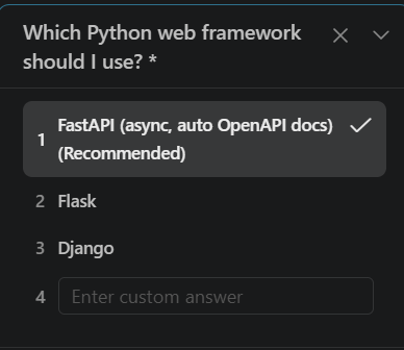 |
| **Storage Engine** | 1: PostgreSQL + Redis<br>2: SQLite only<br>3: SQLite + Redis | **2: SQLite only** | I choose SQLlite only because, for other it need external infra dependency but for prototype sql lite is sufficient | 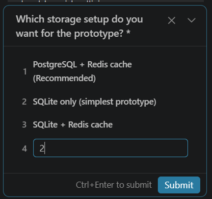 |
| **Authentication** | 1: Simple JWT<br>2: API key per user<br>3: Secret token<br>4: Anonymous | **2: API key per user** | I choose Api key per user because , URL shortening services are predominantly consumed via scripts, CLI tools, CI pipelines, and external application integrations. An X-API-Key header allows clients to authenticate statelessly in a single HTTP request without executing interactive login handshakes, password management flows, or token-refresh roundtrips. | 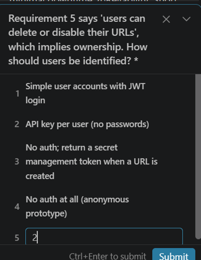 |
| **Redirect Status** | 1: 302 temporary<br>2: 301 permanent | **1: 302 temporary** | I choose 302 because it guarantees Click Analytics Ingestion and instant Link revocation and TTL Expiry | 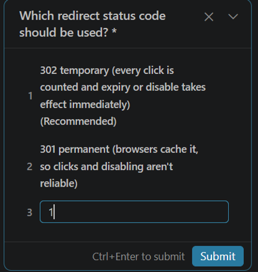 |
| **Expiration** | 1: TTL or absolute (410)<br>2: Absolute only (404) | **1: TTL or absolute (410)** | I choose 410 because it indicates explicitly clients that the resource did exist previously, but has expired or been intentionally revoked. With 404 , it indicates short code never existed or invalid | 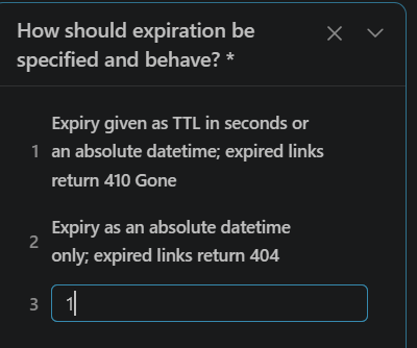 |
| **Analytics Scope**| 1: Count + timestamp<br>2: Hashed IP, UA, referrer<br>3: Daily aggregates | **2: Hashed IP, UA, referrer** | I chose hashed IP, user agent, and referrer to provide actionable traffic insights—such as platform source and unique visitors—while respecting user privacy via hashing. Because telemetry is processed asynchronously in the background, this richer data capture adds zero latency to the redirect. | 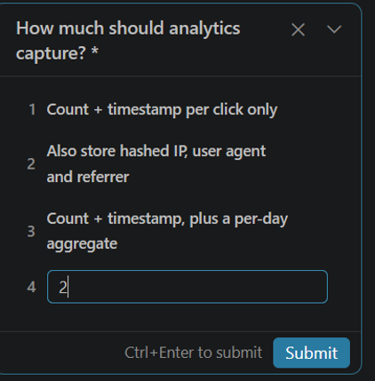 |
| **Malicious Links**| 1: Scheme/IP/private checks + local blocklist<br>2: Google Safe Browsing<br>3: Basic scheme | **1: Scheme/IP/private checks + local blocklist** | Self-Contained & Frictionless: It provides robust security checks without forcing anyone to set up a third-party Google Cloud API key to run the project or test suite. Defends Against Real Vulnerabilities: It blocks dangerous protocol schemes (javascript:) and guards against SSRF by rejecting loopback and private IP addresses (127.0.0.1, localhost). Easy to Test: Security edge cases can be tested deterministically in unit tests using the local blocklist | 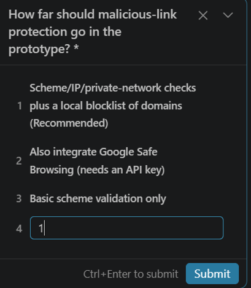 |
| **Execution Gate** | 1: Plan only<br>2: Build prototype now<br>3: Build in phases | **1: Plan only** | Chosen only plan because to keep engineer to control and review before execution and avoids auto creation. | 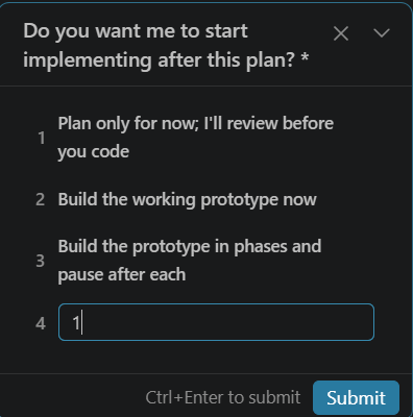 |

---

## 3. Human Architectural Interventions (Overriding AI Flaws)

### Initial Plan Generation Prompt (Verbatim)
```text
please create a document with this tasks.
```

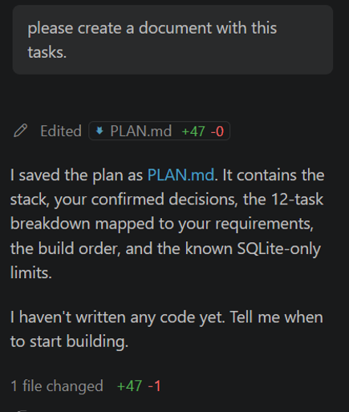
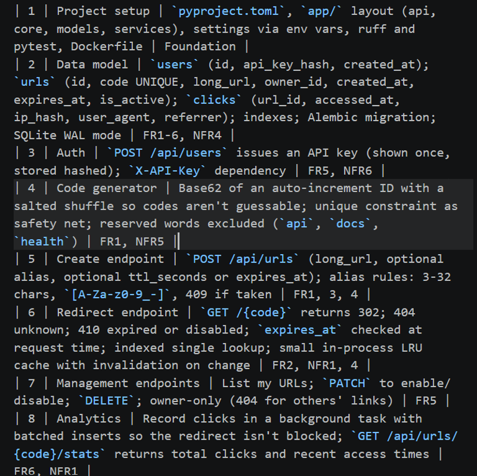

### Flaws Identified in AI Proposal & Remediation
1. **Rejection of Task 4 Auto-Increment ID Base62 in Favor of CSPRNG Random Strings:**
   - *AI Proposal:* Base62 encoding of an auto-increment integer ID with a salted shuffle.
   - *Flaw:* SQLite requires an insert to obtain an auto-increment ID. If you encode the ID after insertion, you must execute a two-step query (INSERT dummy → get id → UPDATE short code). Furthermore, sequential ID shuffling is prone to enumeration risks if the salt leaks.
   - *Engineer Solution:* Enforced generating 7-character Base62 tokens in memory using Python's cryptographically secure random number generator. If a collision occurs against the unique index, retry with exponential backoff (up to 3 times). This is completely stateless and eliminates the two-step database write.
2. **Refine Task 8's Analytics Ingestion for SQLite:**
   - *AI Proposal:* In-memory batched inserts in a background task.
   - *Flaw:* In-memory batch accumulation inside an ASGI worker risks losing uncommitted click events on server restarts or worker crashes. Moreover, running batch insert threads against SQLite can trigger `sqlite3.OperationalError: database is locked` if connection timeouts are not configured properly.
   - *Engineer Solution:* Use standard FastAPI BackgroundTasks executing individual async insertions per redirect, configure SQLite with `PRAGMA journal_mode=WAL;`, and set `busy_timeout = 5000` (5 seconds) on the SQLAlchemy engine.
3. **Standardize API Versioning (Tasks 3, 5, 7, 8):**
   - *AI Proposal:* Flat paths like `POST /api/urls`, `GET /api/urls/{code}/stats`.
   - *Engineer Solution:* Enforce standard REST API versioning: prefix all resource routes with `/api/v1/` (e.g., `/api/v1/urls`, `/api/v1/urls/{code}/analytics`). Keep public redirect resolution at the root (`GET /{code}`).

### Intervention Prompt Dispatched (Verbatim)
```text
Do not write or generate any code yet.
Please update PLAN.md to reflect these three engineering decisions:
Task 4 (Token Generation): Replace the auto-increment + salted shuffle with 7-character Base62 tokens generated in memory using secrets.choice, backed by a 3-attempt retry loop on unique collisions.
Task 8 (Analytics): Replace in-memory batching with FastAPI BackgroundTasks, and document SQLite engine configuration for WAL mode (PRAGMA journal_mode=WAL) and a 5000ms busy_timeout.
API Contracts: Standardize all endpoints under /api/v1/ (keeping public redirect at GET /{code}).
Update PLAN.md with these changes, list the updated task sequence, and stop. Wait for my manual review and approval before creating any files or writing implementation code.
```

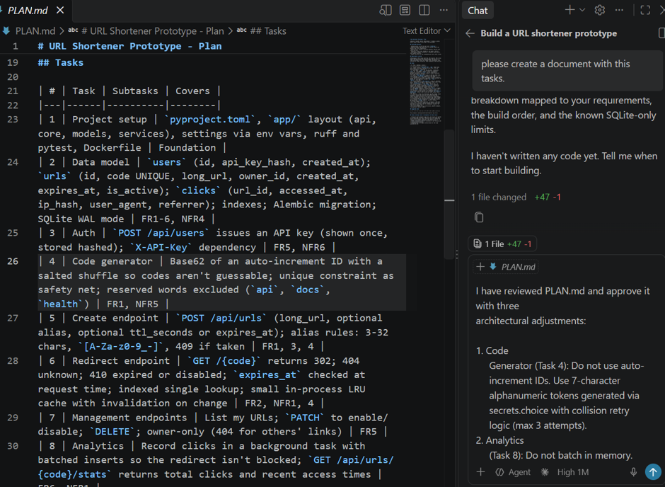
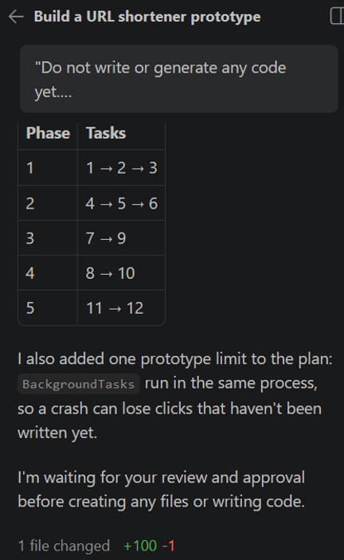

---

## 4. Documentation Separation & Governance

### Doc Split Prompt (Verbatim)
```text
Please split our current project plan into two separate documentation files , SPEC.md (Functional & Requirements Spec) and TECH_DESIGN.md (Technical Architecture & Engineering Spec. keep the plan.md without deleting. After updating docs, do not start implementing any code.
```

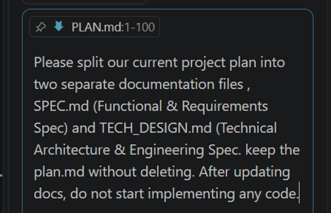
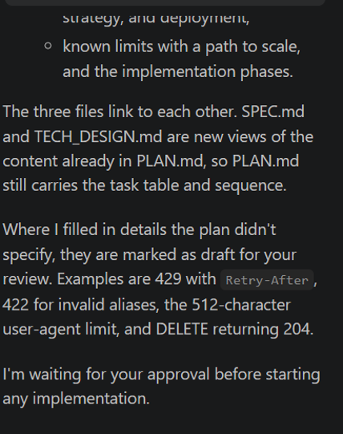

- **Approved Draft Additions:**
  1. Rate limiting: Returns `429 Too Many Requests` with RFC 6585 `Retry-After` header.
  2. Input validation: Enforces `422 Unprocessable Entity` on malformed custom aliases via Pydantic.
  3. Storage protection: Caps incoming User-Agent strings at 512 characters before click ingestion.
  4. REST conventions: Standardized `DELETE /api/v1/urls/{code}` to return `204 No Content`.

---

## 5. Phased Implementation & Verification Gates

### Phase 1: Foundation, Data Models & Authentication (Tasks 1–3)
#### Prompt Dispatched (Verbatim)
```text
Please implement Phase 1: Foundation, Data Models, and Authentication (Tasks 1, 2, and 3) according to PLAN.md and TECH_DESIGN.md:
Task 1 — Project Layout & Settings:
Create the project tree: app/api/v1, app/core, app/models, app/services, and tests/.
Configure pyproject.toml with dependencies (fastapi, uvicorn[standard], sqlalchemy>=2.0, alembic, pydantic-settings) and test tools (pytest, httpx, ruff).
Create app/core/config.py using pydantic-settings to load environment variables prefixed with URLSHORT_ (including database_url, sqlite_busy_timeout_ms, api_key_pepper, and api_v1_prefix).
Provide the non-root Dockerfile.
Task 2 — Database Models & SQLite Configuration:
Configure the SQLAlchemy 2.0 engine in app/core/database.py with check_same_thread=False and a connect event listener applying:
PRAGMA journal_mode=WAL;
PRAGMA busy_timeout=5000;
PRAGMA foreign_keys=ON;
PRAGMA synchronous=NORMAL;
Define declarative models in app/models/:
User: id, api_key_hash (unique), created_at (UTC).
URL: id, code (unique), long_url, owner_id (FK to users.id on delete cascade), created_at (UTC), expires_at (nullable, UTC), is_active (boolean, default True). Composite index on (owner_id, created_at).
Click: id, url_id (FK to urls.id on delete cascade), accessed_at (UTC), ip_hash, user_agent, referrer. Composite index on (url_id, accessed_at).
Set up Alembic with render_as_batch=True in env.py and generate the initial migration.
Task 3 — Authentication & Core User Routes:
In app/core/security.py, implement HMAC-SHA256 hashing using the configured api_key_pepper.
Implement POST /api/v1/users: generate a 32-byte secure key with secrets.token_urlsafe(32), store its HMAC-SHA256 hash, and return the plaintext key once (HTTP 201).
Implement the get_current_user FastAPI dependency validating the X-API-Key header against users.api_key_hash, returning 401 Unauthorized with WWW-Authenticate: ApiKey on failure.
Expose GET /api/v1/users/me protected by this dependency.
Automated Tests:
Write a pytest suite in tests/ using a temporary file-backed SQLite database (tmp_path) to verify:
SQLite pragmas are actively applied on connection.
User creation returns the raw key and stores only the hashed key.
GET /api/v1/users/me succeeds with a valid key and fails with 401 on missing or invalid keys.
Foreign key cascades delete associated child records.
Execution Constraint: Implement Phase 1 only. Run the tests, report the status, and stop. Do not implement URL creation, redirection, or any Phase 2 routes.
```

- **Verification Evidence:**
  1. Copilot requested terminal access to inspect files before execution; authorization was audited and approved.
  2. 14 automated tests passed in 0.35s (`pytest -v`).
  3. Server booted cleanly with Uvicorn on `http://127.0.0.1:8000`.
  4. OpenAPI contracts verified via Swagger UI (`/docs`), demonstrating strict route isolation under `/api/v1/users` and zero scope creep.
- **Plan Update Prompt:**
  ```text
  Under Tasks, Add a Status column to show that Tasks 1–3 are done and Tasks 4–6 are in progress:
  Updated task sequence, Update the Phase table to show Phase 1 complete:
  ```

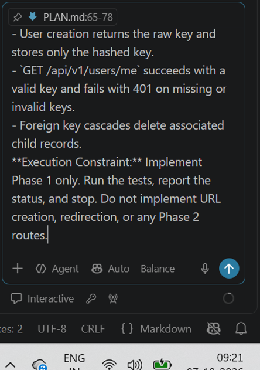
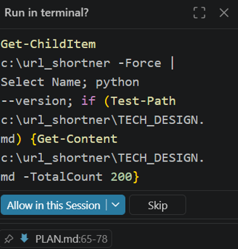
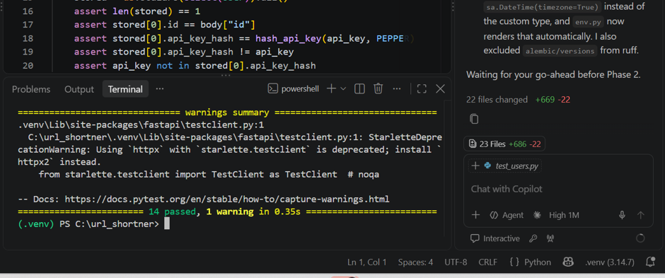
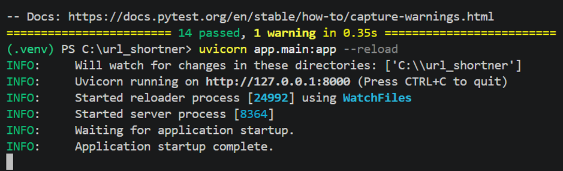
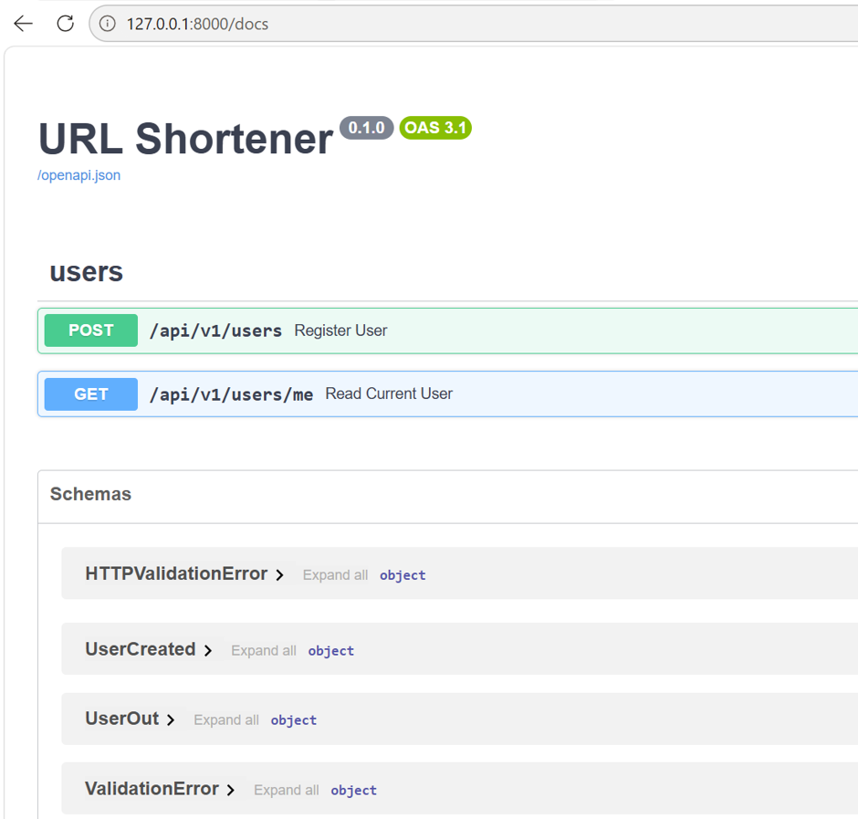

---

### Phase 2: Core Value Loop & Concurrency Pre-Planning (Tasks 4–6)
#### Prompt Dispatched (Verbatim)
```text
Proceed with Phase 2: Core Value Loop (Tasks 4, 5, and 6) strictly per Docs/SPEC.md and Docs/TECH_DESIGN.md:
Task 4 — Token Generator Service (app/services/token_service.py):
Generate 7-character Base62 tokens ([A-Za-z0-9]) using secrets.choice.
Reject reserved system words (api, docs, health, redoc, openapi.json).
Validate custom aliases against ^[A-Za-z0-9_-]{3,32}$, returning 422 Unprocessable Entity for invalid patterns.
Implement collision handling on database insert: retry up to 3 times on unique constraint violations before raising an exception mapping to 503 Service Unavailable.
Task 5 — URL Creation Route (POST /api/v1/urls):
Require X-API-Key authentication via the get_current_user dependency.
Input schema: long_url (must be valid HTTP/HTTPS), optional custom_alias, and mutually exclusive ttl_seconds or expires_at (UTC). Raise 422 if both are supplied or values are invalid.
Return 201 Created with code, short_url, long_url, created_at, expires_at, and is_active.
Return 409 Conflict if a requested custom alias is already taken.
Task 6 — Public Redirect Route (GET /{code}):
Mount at the application root, evaluated after /api/v1 routes.
Add an in-memory LRU cache layer for active link lookups with invalidation support.
Evaluate status at request time:
Unknown code -> 404 Not Found.
is_active == False or expires_at <= now(UTC) -> 410 Gone.
Active -> 302 Found with Location header pointing to long_url.
Do not implement click logging or analytics ingestion yet (reserved for Phase 4).
Tests:
Add tests in tests/test_urls.py and tests/test_redirect.py covering:
Token generation randomness, Base62 charset, and length.
Alias rules: custom alias creation, reserved path rejections, regex validation (422), and conflicts (409).
Expiration logic: TTL vs explicit UTC datetime, 302 vs 410 on expired links.
Collision retry mechanism and 503 exhaustion trigger.
LRU cache hit and invalidation behavior.
Execution Constraint: Implement Phase 2 only. Run the full test suite (pytest -v), report results, and stop for review before touching Phase 3.
```

- **Proactive AI Warning Triaged by Engineer:** Copilot flagged a race condition between `GET /{code}` and link management (`PATCH` / `DELETE` in Task 7). Late-finishing redirect reads could repopulate the LRU cache with stale data after invalidation.
- **Resolution Plan:** Added explicit requirement in Task 7 to mitigate redirect cache invalidation races.

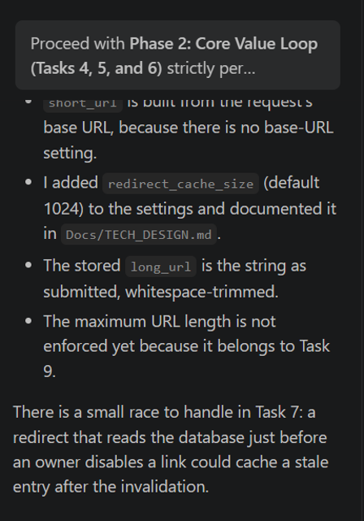

---

### Phase 3: Management Endpoints & Edge Security Hardening (Tasks 7 & 9)
#### Prompt Dispatched (Verbatim)
```text
Phase 2 is verified (98 tests passing, ruff clean) and committed. Proceed with Phase 3: Management Endpoints & Edge Security Hardening (Tasks 7 & 9) strictly per Docs/SPEC.md and Docs/TECH_DESIGN.md:
Task 7 — URL Management Endpoints (app/api/v1/urls.py):
Require get_current_user (X-API-Key) across all management endpoints.
GET /api/v1/urls: List all URLs owned by caller; support pagination (limit, offset) sorted by created_at descending.
PATCH /api/v1/urls/{code}: Accept {"is_active": bool}. Toggle link status.
DELETE /api/v1/urls/{code}: Permanently delete link (and cascade clicks).
Ownership enforcement: Return 404 Not Found (not 403) if code does not exist OR is owned by another user (prevent enumeration).
Cache Invalidation Concurrency Fix: Prevent the read-after-invalidation stale cache race condition when toggling or deleting links. Implement an invalidation tombstone or last-modified version/timestamp guard in app/services/link_cache.py so in-flight redirect reads cannot repopulate invalidated keys with stale data.
Task 9 — Security Hardening & Rate Limiting (app/core/security.py, app/middleware/):
URL Sanitization & SSRF Defense: Enforce scheme (http, https only), maximum URL length (2048 chars), prohibit recursive/self-referential redirects to own host, and block private/link-local/loopback IPs (127.0.0.0/8, 10.0.0.0/8, 172.16.0.0/12, 192.168.0.0/16, 169.254.0.0/16, ::1, fc00::/7, fe80::/10) resolved via DNS.
Domain blocklist lookup against app/core/blocked_domains.txt (or configuration list).
Rate Limiting: In-memory token bucket rate limiter:
Per IP and per API key on POST /api/v1/urls (write paths).
Per IP on GET /{code} (redirect read path).
Return 429 Too Many Requests with Retry-After header when limit is exceeded.
Headers & CORS: Add security headers middleware (X-Content-Type-Options: nosniff, X-Frame-Options: DENY, Referrer-Policy: strict-origin-when-cross-origin) and configure CORS.
Tests:
Add comprehensive tests in tests/test_management.py and tests/test_security.py:
Ownership authorization: 404 on managing another user's link.
PATCH / DELETE cache invalidation and race prevention.
SSRF filters: localhost, 127.0.0.1, private IPs, non-HTTP schemes, domain blocklist.
Token bucket rate limiter: trigger 429 and verify Retry-After.
Execution Constraint: Implement Phase 3 only. Run pytest -v, ensure linting with ruff check . passes, and report results before moving to Phase 4
```

- **Verification Evidence:** 246 passed in 7.58s (`pytest -v`). Confirmed that temporary removal of cache load tickets caused 6 tests to fail, validating the race fix.

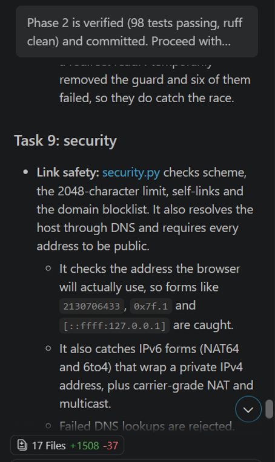

---

### Phase 4: Click Analytics Pipeline & Operational Reliability (Tasks 8 & 10)
#### Prompt Dispatched (Verbatim)
```text
Phase 3 is verified (246 tests passing, ruff clean) and committed. Proceed with Phase 4: Analytics Pipeline & Operational Reliability (Tasks 8 & 10) strictly per Docs/SPEC.md and Docs/TECH_DESIGN.md:
1. Task 8 — Click Analytics Pipeline (app/services/analytics_service.py, app/api/v1/urls.py):
   - Asynchronous Click Recording: On GET /{code}, log clicks asynchronously so the 302 redirect latency is never blocked by database click writes (using FastAPI BackgroundTasks or an in-memory buffered worker).
   - Event Schema: url_id, clicked_at (UTC), referrer (nullable, sanitized), user_agent (nullable, truncated), and anonymized/hashed IP address (never store raw visitor IPs).
   - Handle database busy/locked states gracefully so failed analytics writes do not crash the redirect.
   - Analytics Query Route: GET /api/v1/urls/{code}/analytics:
     - Secured by get_current_user (X-API-Key); owner-only (return 404 for non-owners or missing links).
     - Return total clicks, click time-series buckets (e.g. hourly or daily), top referrers, and recent clicks.
2. Task 10 — Reliability & Operational Readiness (app/main.py, app/core/):
   - Health Probe: GET /health endpoint verifying application status and running a lightweight SQLite probe (SELECT 1). Return 200 with database health status.
   - Graceful Shutdown: Implement FastAPI lifespan handler to flush remaining in-flight analytics events from memory before process termination.
   - Database Resilience: Ensure SQLite WAL mode and busy timeouts are configured for concurrent read/write throughput during click spikes.
3. Tests:
   - Add tests in tests/test_analytics.py and tests/test_reliability.py:
     - Verify GET /{code} records click event without degrading redirect behavior.
     - Verify analytics aggregation route, pagination, and ownership isolation (404 on others' links).
     - Verify IP anonymization logic.
     - Verify /health probe returns 200 and surfaces database availability.
     - Verify graceful buffer flush on application shutdown.
Execution Constraint: Implement Phase 4 only. Run pytest -v, verify ruff check . passes, and report results before moving to the final Phase 5.
```

- **Conflict Resolved:** Copilot flagged a tension between direct `BackgroundTasks` and Task 10's lifespan shutdown flush. The engineer approved Option 1: in-memory bounded queue with batched `executemany` database writes to eliminate SQLite lock contention.
- **Verification Evidence:** 328 passed in 13.22s

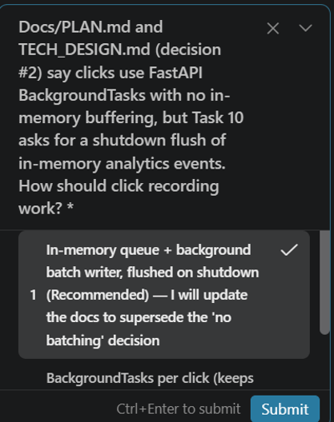

---

### Phase 5: Concurrency Verification, Smoke Testing & Final Delivery (Tasks 11 & 12)
#### Prompt Dispatched (Verbatim)
```text
Phase 4 is verified (328 tests passing in local terminal, ruff clean) and committed. Proceed with Phase 5: Concurrency Verification, End-to-End Smoke Testing, and Final Documentation (Tasks 11 & 12) per Docs/SPEC.md and Docs/PLAN.md:
Task 11 — Concurrency & Performance Verification (scripts/load_test.py or tests/test_performance.py):
Create an automated concurrency harness verifying:
100+ concurrent redirect requests (GET /{code}) against both cached and uncached links without SQLite database lock errors.
Concurrent link creation testing token collision retry behavior and alias race isolation.
Click analytics batching throughput under burst traffic without dropping 302 responses.
Task 12 — End-to-End Smoke Script & Final Delivery (scripts/smoke_test.py, README.md):
Create scripts/smoke_test.py: A standalone, zero-dependency script (using Python standard library urllib) that executes against a running server (http://127.0.0.1:8000) and tests the complete business lifecycle:
User registration & API key generation.
Health probes (GET /health and GET /api/v1/health).
SSRF defense (blocking 127.0.0.1, localhost, and AWS metadata IP 169.254.169.254).
Short link creation (generated code and custom alias).
Redirection (302 Found, Location header, and security headers).
Analytics ingestion & aggregation (GET /api/v1/urls/{code}/analytics verifying click count, referrer sanitization, and time-series structure).
Management actions: disable link (immediate 410 Gone), delete link (immediate 404 Not Found), and foreign tenant access (anti-enumeration 404).
Update README.md with comprehensive instructions:
Requirements, virtual environment setup, and dependency installation.
Database initialization and running migrations.
Running the Uvicorn server.
Running the test suite (pytest) and static analysis (ruff).
Executing the live smoke test script.
Configuration options table (including rate limits, cache size, and public_base_url).
Update Docs/PLAN.md to mark all tasks (Tasks 1–12) and all phases (Phases 1–5) as Done/Complete.
Execution Constraint: Run pytest -v, run ruff check ., and confirm scripts/smoke_test.py is ready for live execution.
```

- **Critical Defect Discovery — Connection Pool Starvation:**
  During high-concurrency burst tests, requests suffered 30-second stalls followed by 500 errors.
  - *Root Cause:* SQLAlchemy pool ceiling (15 connections) starved against FastAPI's `anyio` threadpool (40 threads).
  - *Human Audit & Fix Approved:* Converted database dependency to an async generator, enforced explicit early `db.close()` immediately following read queries, and deferred database acquisition until after external DNS validation.
- **Final Quality Gates Achieved:**
  - Full automated suite: **342 passed** in 15.03s.
  - Concurrency & load suite: **14 passed** in 5.76s / 7.70s.
  - Standalone live smoke test: **75/75 passed** in 3.40s.

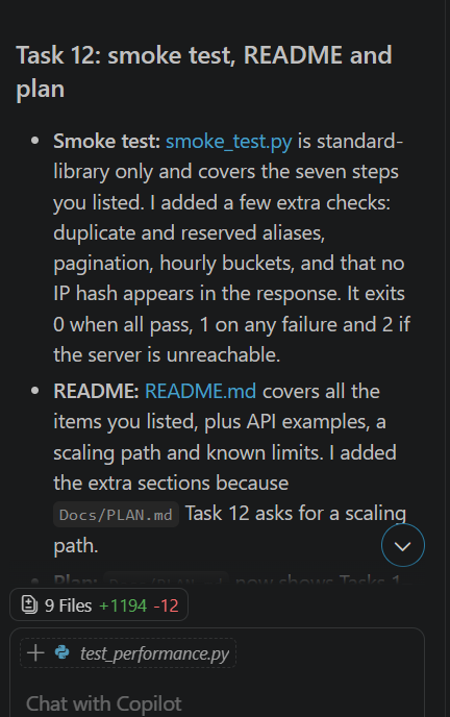

---

## 6. Reviewer Verification Guide

To independently verify the complete delivery:

```powershell
# 1. Inspect repository documentation tree
Get-ChildItem Docs/

# 2. Run automated test suite (342 unit & integration tests)
pytest -v

# 3. Run performance & concurrency test suite (14 stress tests)
pytest tests/test_performance.py -v

# 4. Execute the live end-to-end smoke test against the running server
python scripts/smoke_test.py
```